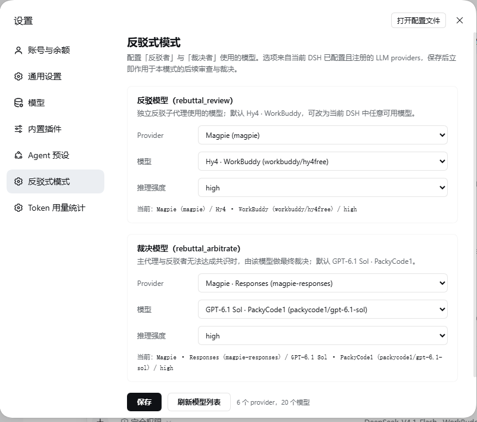
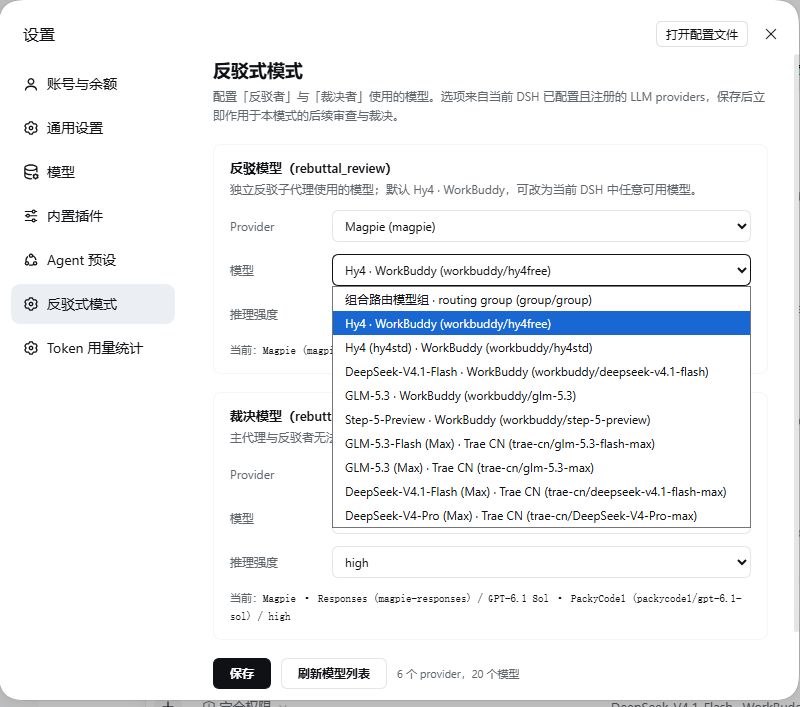

# DSH DeepSeek 自定义插件集

面向 [DeepSeek Harness (dsh)](https://github.com/deepseek-ai/deepseek-harness) 的开源 bundle 插件集合，按 dsh 的本地 bundle 规范组织为 monorepo：

```
packages/
  recent-sessions/       左侧栏“最近会话”面板
  token-daily-stats/     Token 用量统计（设置页）
  rebuttal-mode/         反驳式 Agent Preset（主模式 + 反驳者 + 裁决者）
  rebuttal-settings-ui/  反驳式模式的模型配置设置页
```

## 插件

### 1) recent-sessions — `@local/recent-sessions`

左侧栏的“最近会话”折叠列表：

- 列表高度约 150px、可滚动、可展开/折叠；
- 显示会话状态图标与相对更新时间；当前会话高亮并自动滚动定位；
- 单击会话：打开会话，并在左侧“工作区”会话树中滚动定位（必要时自动展开工作区分组）；
- 悬停显示与宿主一致的信息卡（标题 / 工作区文件夹路径 / 相对时间 / 状态）；
- 右键菜单：新建会话（该工作区）、重命名会话、复制 Session ID、打开所在文件夹、归档会话。

细节见 [packages/recent-sessions/README.md](packages/recent-sessions/README.md)。

### 2) token-daily-stats — `@local/token-daily-stats`

设置页“Token 用量统计”分区：按天 + 按模型统计所有会话（含子代理）的 token 消耗。Host 半持久化到 `<DSH_HOME>/storages/`。

细节见 [packages/token-daily-stats/README.md](packages/token-daily-stats/README.md)。

### 3) rebuttal-mode — `@local/dsh-rebuttal-mode`

「反驳式模式」Agent Preset 的核心包：

- 用户可选择 `rebuttal` 模式，运行在主代理上；
- 内置 `rebuttal-critic`（反驳者）与 `rebuttal-arbiter`（裁决者）两个内部预设；
- 提供 `rebuttal_review` / `rebuttal_arbitrate` 工具与执行守卫；
- 默认反驳模型为 **Hy4 · WorkBuddy**，默认裁决模型为 **GPT-6.1 Sol · PackyCode1**；
- 模型可改，详见 `rebuttal-settings-ui`。

细节见 [packages/rebuttal-mode/README.md](packages/rebuttal-mode/README.md)。

### 4) rebuttal-settings-ui — `@local/dsh-rebuttal-settings-ui`

「反驳式模式」的模型配置页：Settings → 反驳式模式，读取当前 DSH 可用 LLM providers/models，选择反驳模型和裁决模型。





细节见 [packages/rebuttal-settings-ui/README.md](packages/rebuttal-settings-ui/README.md)。

## dsh 插件规范 / 目录结构

每个插件包都是一个独立的 dsh bundle：

```
<package>/
  package.json         # 声明 dsh.bundle.patch 与 dsh.client
  cordis.patch.yml     # bundle 的 patch 层（insert 插件行）
  index.js             # Host 半（可为空实现）
  client.js            # Client 半（有 Web UI 时；window.__ModuleLoader__.load 模块）
  locale/en.json       # 插件管理展示用 title/description
  locale/zh.json
  icon.svg             # 插件图标（<=256KiB）
  README.md
```

`package.json` 关键字段：

```json
{
  "dsh": {
    "bundle": { "patch": "./cordis.patch.yml" },
    "client": { "platform": "web", "immediately": true }
  },
  "exports": { ".": "./index.js", "./client": "./client.js", "./locale/*.json": "./locale/*.json", "./icon": "./icon.svg" }
}
```

## 安装（本地 bundle 安装）

dsh 的安装是**链接指向插件源码目录**（不是复制），所以请把仓库放在稳定目录，安装后不要随意移动/删除。

1. 在本机 dsh 中逐个安装包目录（等价于 `plugin_manager` 的 `install_bundle`，target = 包的绝对路径）：
   - `packages/recent-sessions`
   - `packages/token-daily-stats`
   - `packages/rebuttal-mode`
   - `packages/rebuttal-settings-ui`（必须与 `rebuttal-mode` 一起安装）
2. 安装会把 `@local/*` 写入目标 profile 的 `package.json`（`dependencies` 的 `link:` + `dsh.profile.bundles`）。
3. `token-daily-stats`、`rebuttal-mode` 的 Host 半只在 dsh 启动时加载，安装后**重启 dsh**。

### 依赖与兼容性

- 需与插件源码对应的 dsh 版本（客户端 slot 与 `@deepseek-ai/dsh-client-ui-primitives` 接口相关），跨大版本可能不显示或报错。
- “打开所在文件夹”使用 dsh 自带 `dsh-host-open-in-app` 的 `/open-in-app/apps` 与 `/open-in-app/open` 路由；标准 Web 配置默认包含。
- “归档会话”调用宿主 `uiWorkspace.archiveSession`；会话正在工作时可能被宿主拒绝。

## 许可证

[MIT](LICENSE)
